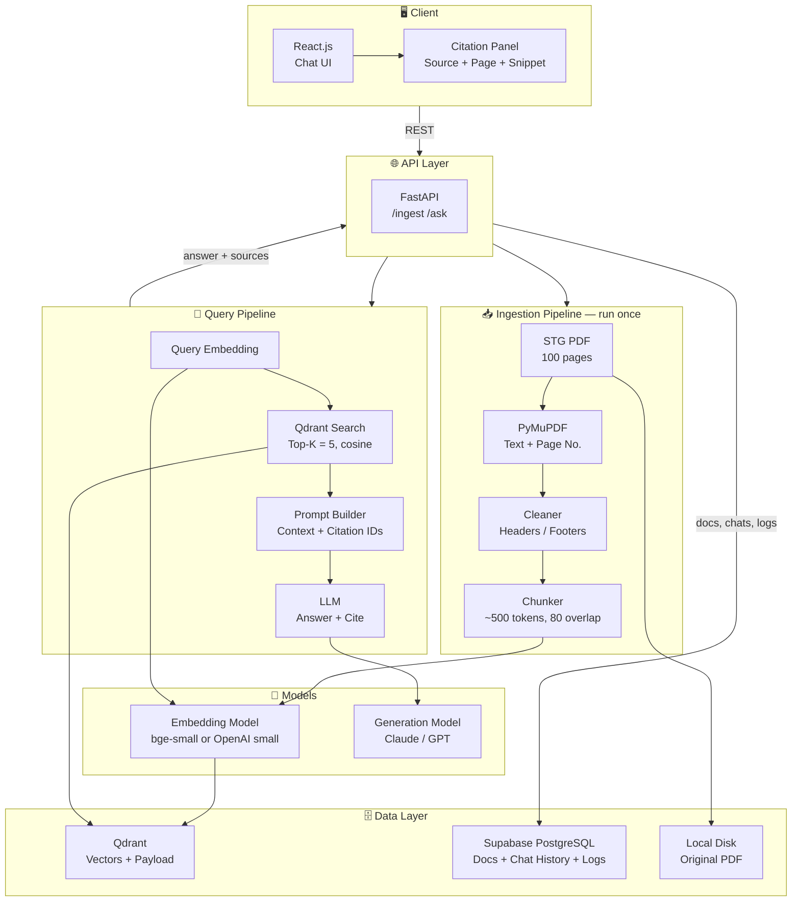
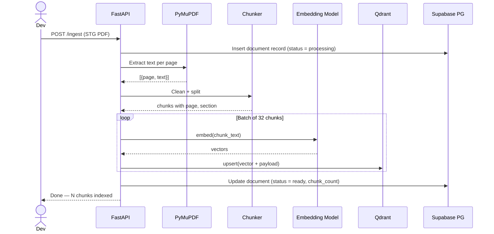
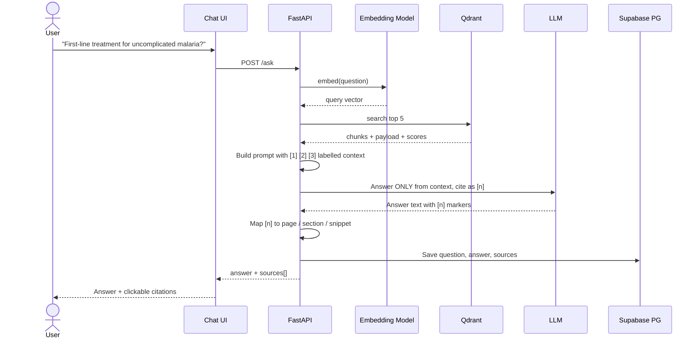

# STG-RAG — Design & Architecture

> Demo RAG system over **Standard Treatment Guidelines** (100 pages). Ask a clinical question → get a grounded answer with page-level citations. Vector store: **Qdrant**.

> ⚠️ **Demo scope.** Single document, single collection, no auth, no multi-tenancy. Not for real clinical use.

---

## 1. High-Level Architecture



---

## 2. Data Flow

### 2a. Ingestion (one-time)



### 2b. Question → Answer with Citations



---

## 3. Directory Structure

```
stg-rag/
├── data/
│   └── stg.pdf                  # 100-page subset
│
├── backend/
│   ├── main.py                  # FastAPI app
│   ├── api/
│   │   ├── ingest.py            # POST /ingest
│   │   └── ask.py               # POST /ask
│   ├── db/
│   │   ├── session.py           # Supabase Postgres connection
│   │   └── models.py            # SQLAlchemy tables
│   ├── core/
│   │   ├── config.py            # env, model names, top_k
│   │   ├── parser.py            # PDF → pages
│   │   ├── chunker.py           # pages → chunks
│   │   ├── embedder.py          # text → vector
│   │   ├── vector_store.py      # Qdrant client wrapper
│   │   ├── retriever.py         # query → top-k chunks
│   │   ├── prompt.py            # context + citation prompt
│   │   └── generator.py         # LLM call + citation mapping
│   └── schemas.py               # Pydantic request/response
│
├── frontend/                    # React.js app
│   └── src/
│       ├── components/          # ChatWindow, CitationPanel
│       ├── pages/               # Chat
│       └── api.js               # calls FastAPI
├── docker-compose.yml           # qdrant + backend
└── .env.example
```

---

## 4. Tech Stack Reference

| Layer | Tech | Role | Notes |
|-------|------|------|-------|
| **UI** | React.js ✓ | Chat + citation panel | Vite for setup |
| **API** | FastAPI ✓ | `/ingest`, `/ask` | Python, async |
| **PDF parsing** | PyMuPDF ✓ | Text + page numbers | Alt: pdfplumber (better tables) |
| **Chunking** | Custom / LangChain splitter | ~500 tokens, 80 overlap | Split on headings first if possible |
| **Embeddings** | `bge-small-en-v1.5` ✓ | 384-dim, runs locally, free | Alt: OpenAI `text-embedding-3-small` |
| **Vector DB** | **Qdrant** ✓ | Vector search + payload filters | Docker, port 6333 |
| **Relational DB** | **Supabase PostgreSQL** ✓ | Document records, chat history, query logs | Managed Postgres, free tier |
| **ORM** | SQLAlchemy | DB access from FastAPI | Alt: supabase-py client |
| **LLM** | Claude / GPT | Grounded answer generation | Temperature 0 |
| **Orchestration** | Plain Python ✓ | Retrieve → prompt → generate | LangChain optional, not needed |
| **Infra** | Docker Compose | Qdrant + backend locally; Supabase is hosted | Deploy later if needed |

---

## 5. Qdrant Collection Design

One collection: `stg_chunks`

```
vector:   384-dim, cosine distance

payload:
  chunk_id     : int
  text         : str          -- the chunk text (shown as snippet)
  page_start   : int          -- for citation
  page_end     : int
  section      : str          -- nearest heading, e.g. "Malaria"
  source       : str          -- "stg.pdf"
```

Payload indexes on `section` and `page_start` so filters stay fast.

---

## 6. Supabase PostgreSQL Schema (Core Tables)

Postgres holds app data. Qdrant holds only vectors and chunk payload.

```sql
documents (
  id uuid PK, name, file_path,
  page_count int, chunk_count int,
  status,               -- processing | ready | failed
  created_at
)

chat_sessions (
  id uuid PK, created_at
)

messages (
  id uuid PK, session_id FK,
  role,                 -- user | assistant
  content text,
  sources jsonb,        -- [{id, page, section, snippet, score}]
  latency_ms int,
  created_at
)
```

---

## 7. Citation Strategy

1. Every chunk carries `page_start`, `page_end`, `section` from ingestion.
2. Retrieved chunks are numbered `[1]..[5]` in the prompt.
3. LLM is told: *answer only from the context, cite each claim as `[n]`, say "not found in the guidelines" if unsure.*
4. Backend maps `[n]` back to the chunk and returns:

```json
{
  "answer": "Artemether-lumefantrine is the first-line ... [1]",
  "sources": [
    { "id": 1, "page": "42", "section": "Malaria", "snippet": "...", "score": 0.81 }
  ]
}
```

5. UI shows the answer with clickable `[n]` → opens source snippet + page.

---

## 8. Key Design Decisions

| Decision | Choice | Why |
|----------|--------|-----|
| Vector DB | Qdrant | Fast setup in Docker, payload filtering, good Python client |
| Frontend | React.js | Chat UI with clickable citations |
| App database | Supabase PostgreSQL | Managed Postgres for docs and chat history, no setup |
| Parsing | PyMuPDF | Fast, keeps page numbers, easy for 100 pages |
| Chunk size | ~500 tokens, 80 overlap | Keeps one treatment section together |
| Embeddings | bge-small (local) | Free, no API key, good enough for demo |
| Top-K | 5 | Enough context, low noise |
| Citations | Page + section in payload | Cheap and reliable; no extra model needed |
| Hallucination guard | "Answer only from context" prompt | Simple; refuse when no match |
| Framework | Plain Python | Less moving parts for a demo |

---

## 9. Build Order (demo — ~2 days)

### Phase 1 — Ingestion
- [ ] Run Qdrant via Docker Compose; create Supabase project + tables
- [ ] Parse 100 pages with PyMuPDF (keep page numbers)
- [ ] Chunk + attach page / section metadata
- [ ] Embed and upsert into `stg_chunks`
- [ ] Save document record in Postgres

**Deliverable:** Collection has all chunks; a test search returns relevant text.

### Phase 2 — Query + Citations
- [ ] `/ask` endpoint: embed → search → prompt → LLM
- [ ] Citation mapping `[n]` → page / section / snippet
- [ ] "Not found in guidelines" fallback
- [ ] Save chat messages + sources in Postgres

**Deliverable:** Question returns an answer with correct page citations.

### Phase 3 — UI + Polish
- [ ] React chat UI with citation panel
- [ ] A few sample questions as buttons
- [ ] Small README

**Deliverable:** Working demo you can show end to end.

---

## 10. Later (out of demo scope)

- Hybrid search (BM25 + vector) and a reranker
- Table-aware parsing for dosage tables
- Eval set of 20 Q&A pairs to check retrieval quality
- Auth, multiple documents, streaming responses
